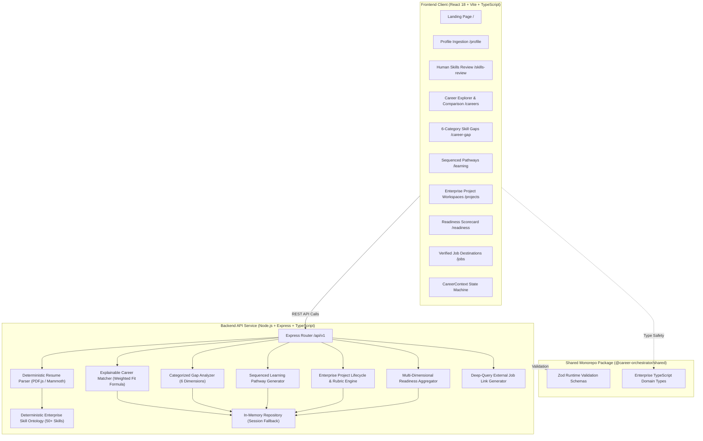

# CAREER ORCHESTRATOR — HACKATHON DEMO GUIDE
> **SAP Hackfest 2026 | Technical Demo Script & Presentation Playbook**

This guide provides the presentation narrative, startup procedures, step-by-step demo flow, and technical architectural walkthrough for the judges and audience at SAP Hackfest 2026.

---

## 1. Quick-Start Commands

To run Career Orchestrator locally for the live demo:

### Step 1: Start the Backend Service
Open a terminal in `K:\SAP`:
```powershell
# From workspace root
npm run start:backend
# Or with live reload:
npm run dev:backend
```
*The Express API will be running on `http://localhost:5000` (Health Check: `http://localhost:5000/api/v1/health`).*

### Step 2: Start the Frontend Application
Open a second terminal in `K:\SAP`:
```powershell
# Production preview (recommended for rock-solid demo performance):
npm run preview:frontend
# Or development mode with hot reload:
npm run dev:frontend
```
*Open your browser at `http://localhost:4173` (preview) or `http://localhost:5173` (dev).*

---

## 2. System Architecture



---

## 3. Candidate User Journey

```mermaid
flowchart LR
    A["1. Resume Upload / Profile"] --> B["2. Human Skills Review"]
    B --> C["3. Explore 14 Career Tracks"]
    C --> D["4. Side-by-Side Comparison"]
    D --> E["5. Itemized Skill Gap Delta"]
    E --> F["6. Sequenced Learning Pathway"]
    F --> G["7. Hands-on Project Deliverable"]
    G --> H["8. Career Readiness Scorecard"]
    H --> I["9. Verified Job Applications"]
```



---

## 4. Live Demo Walkthrough (3–5 Minute Script)

### Persona: **Alex Vance / Alex Morgan**
- **Current Role:** Senior Financial & Systems Analyst (5 years general accounting, Excel modeling, SQL auditing).
- **Career Ambition:** Pivot into the high-demand SAP ecosystem as an **SAP S/4HANA Finance Functional Consultant**.
- **Pain Point:** Opaque job descriptions, uncertainty about transferable skills, lack of structured enterprise training, and no verifiable portfolio proof.

---

### ACT I — Landing Page & The Value Proposition (30 Seconds)
- **Navigate to:** `http://localhost:4173/`
- **Narrative:**
  > *"Every year, millions of experienced professionals want to pivot into enterprise ecosystems like SAP, but they get stuck behind jargon, unexplainable black-box AI matchers, and generic course recommendations. Career Orchestrator solves this with explainable AI, human-in-the-loop agency, verified learning journeys, and hands-on portfolio proof."*
- **Action:** Point out the key pillars (Explainable Fit, Human Review, Verified SAP Courses, Portfolio Evidence). Click **"Start Career Transition"** or navigate to `/profile`.

---

### ACT II — Ingestion & Human-in-the-Loop Review (60 Seconds)
- **Navigate to:** `http://localhost:4173/profile` $\to$ `/skills-review`
- **Narrative:**
  > *"Instead of using generative AI that hallucinates skills, our backend employs a deterministic ontology parser supporting genuine PDF and DOCX documents with magic byte verification. Most importantly: we uphold the Human-in-the-Loop principle. The AI suggests competencies, but the candidate owns their profile."*
- **Action:**
  1. Highlight the pre-extracted profile for Alex (or upload `Alex_Vance_Resume.pdf`).
  2. In `/skills-review`, show the candidate reviewing skills:
     - Point out the **Evidence Snippets** highlighting actual lines from the resume.
     - Demonstrate adjusting proficiency (Novice $\to$ Intermediate $\to$ Advanced) or adding a new competency.
     - Click **"Confirm & Save Reviewed Profile"**.

---

### ACT III — Explainable Matching & Role Comparison (45 Seconds)
- **Navigate to:** `http://localhost:4173/careers` and `/careers/compare`
- **Narrative:**
  > *"Our matching algorithm is 100% deterministic and explainable: $100 \times \frac{\sum w_i f_i}{\sum w_i}$. We clearly separate missing mandatory requirements from elective skills so a candidate never gets a false sense of security."*
- **Action:**
  1. Notice **SAP S/4HANA Finance Functional Consultant** is highlighted as a top match (~72% initial fit).
  2. Select **SAP S/4HANA Finance** and **SAP S/4HANA Sourcing & Procurement** to compare side-by-side in `/careers/compare`.
  3. Show the comparison matrix isolating shared transferable skills (SQL, Business Process Mapping) vs role-specific mandatory requirements.

---

### ACT IV — Skill Gap Analysis & Sequenced Learning (45 Seconds)
- **Navigate to:** `http://localhost:4173/career-gap` and `/learning`
- **Narrative:**
  > *"Career Orchestrator breaks gaps into 6 clear categories rather than a vague percentage. We then sequence a personalized roadmap that respects pedagogical prerequisites: business process fundamentals come before customizing; core skills come before integration."*
- **Action:**
  1. In `/career-gap`, point out the 6 groups: Confirmed Matches, Partial Matches, Mandatory Gaps (e.g., *SAP Fiori Financial Apps*), Recommended Gaps, Unverified Requirements, and External Prerequisites.
  2. Show verified resource links directly mapped to official **SAP Learning Hub (Student Edition)** and **openSAP** courses with exact hour estimates.
  3. In `/learning`, show the sequenced milestones and click a milestone checkbox to update progress dynamically.

---

### ACT V — Enterprise Projects & Readiness Scorecard (60 Seconds)
- **Navigate to:** `http://localhost:4173/projects` and `/readiness`
- **Narrative:**
  > *"Course completion alone doesn't prove capability to an SAP hiring manager. Our platform includes 10 enterprise portfolio projects with realistic business scenarios and multi-criteria rubrics."*
- **Action:**
  1. In `/projects`, open **"Enterprise Organizational Blueprint & Company Code Setup"**.
  2. Show the multi-criteria evaluation rubric (Company Code Design 35%, Fiscal Year Variant 35%, Document Principles 30%).
  3. Demonstrate starting the workspace, submitting deliverables, and receiving a rubric score.
  4. Navigate to `/readiness` to display the **Multi-Dimensional Career Readiness Scorecard**:
     $$\text{Readiness} = 0.35 \times \text{Skill} + 0.35 \times \text{Mandatory} + 0.15 \times \text{Learning} + 0.15 \times \text{Projects}$$
  5. Highlight the **Statutory Non-Hiring Guarantee Disclaimer** ensuring compliance and ethics.

---

### ACT VI — Verified Job Destinations (30 Seconds)
- **Navigate to:** `http://localhost:4173/jobs`
- **Narrative:**
  > *"Finally, when ready to apply, we do not scrape private job databases or invent fake openings. We generate authenticated, parameterized deep search queries directly into official platforms: SAP Official Careers (jobs.sap.com), LinkedIn Jobs, and Indeed."*
- **Action:** Show the verified deep links with embedded skill keywords and the **Zero-Fabrication Policy** disclosure.

---

## 5. Offline & Fallback Contingency Plan

If live Wi-Fi fails or the venue network blocks ports during the presentation:
1. **Fully Standalone Monorepo:** The application runs 100% locally on `localhost`. No external cloud or third-party LLM API connectivity is required during runtime.
2. **In-Memory Profile Persistence:** The backend automatically falls back to its robust in-memory repository with clear banner disclosures. All candidate reviews, project submissions, and calculations remain responsive.
3. **Pre-Seeded Alex Morgan Demo Data:** The frontend includes high-fidelity pre-seeded state for Alex Vance/Morgan, allowing all 10 platform views to render immediately with interactive data even if accessed cold.

---

## 6. Technical Innovations Checklist for Judges

| Evaluation Dimension | Hackathon Innovation |
| :--- | :--- |
| **Trust & Explainability** | Zero black-box hallucinations. Match scores and readiness indices are derived from documented, auditable mathematical formulas. |
| **Human-in-the-Loop** | Extracted competencies remain unassessed until reviewed, calibrated, or rejected by the candidate. |
| **SAP Ecosystem Alignment** | Official SAP Learning Hub curricula, SAP Activate methodology, S/4HANA enterprise scenarios, and SAP Horizon enterprise UI design system. |
| **Portfolio-First Evidence** | Replaces passive certificate collection with hands-on enterprise projects assessed against transparent rubrics. |
| **Architectural Rigor** | Monorepo architecture with shared TypeScript contracts, Zod runtime validation, 49 passing automated tests, and 17 passing E2E stages. |
